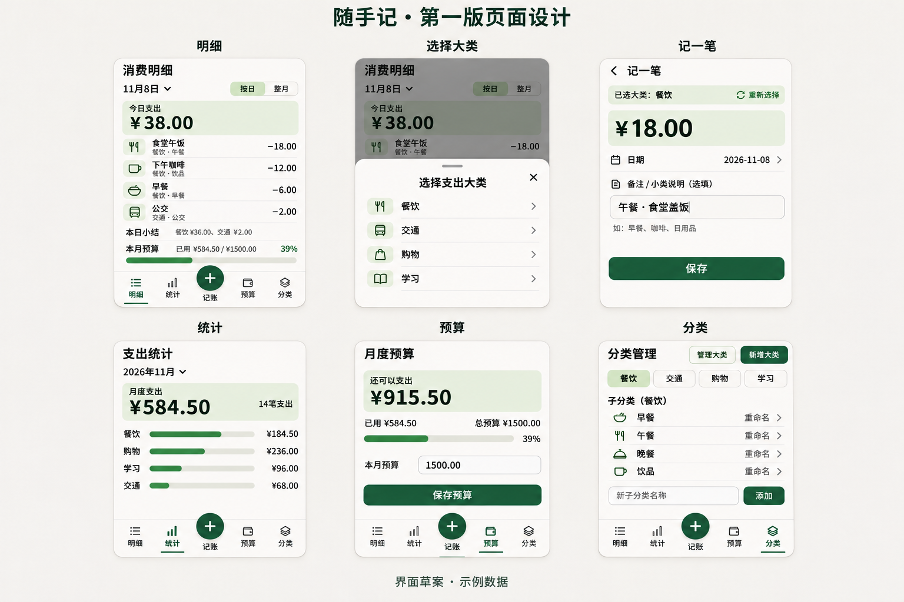

# 随手记 V1.0 产品需求文档（PRD）

| 项目 | 内容 |
| --- | --- |
| 所属项目 | 开源鸿蒙第二次培训作业 / Mini Project |
| 产品名称 | 随手记（暂用名） |
| 文档版本 | V1.0，第一轮开发交接版 |
| 更新日期 | 2026-11-08 |
| 文档用途 | 将已讨论的产品范围、最新交互和验收要求交接给 Codex，开始第一轮开发 |
| 当前状态 | 已有仓颉工程起点及视觉设计稿，记账 App 业务尚未实现 |

> 最新记账流程：点击底部中间的大号“＋” → 弹出大类列表 → 选择大类 → 输入金额 → 可选填写备注说明小类 → 保存。
> 不要沿用“先填金额，再强制选择大类和小类”的旧流程。第一版无需登录或注册。

## 1. 产品目标

面向个人日常支出记录，提供打开即用、离线运行、数据本地保存的记账 App。
以人民币为记账币种，让用户方便地记录每天花费、回看某一天或某个月的消费，并管理月度预算。

核心使用场景：用户午饭花费 18 元，打开 App，点击底部“＋”，选择“餐饮”，输入 `18.00`，
备注“午餐 · 食堂盖饭”，保存后看到当天明细、当天合计和当月预算同步更新。

本轮优先保证真实可用的功能闭环、清楚的页面和可复现的交付。视觉稿是界面参考，不能代替功能实现。

## 2. 已确定的产品范围

以下为第一版必须覆盖的内容，均按最高产品优先级处理。

| 编号 | 功能 | 需求 |
| --- | --- | --- |
| F01 | 每日支出记账 | 输入金额、大类、日期，可填写备注；通过底部中间大号“＋”进入 |
| F02 | 自定义二级分类 | 大类和小类均可新增、重命名；用户自建大类下也可新增小类 |
| F03 | 账单查询 | 按指定日期、月份查看记录 |
| F04 | 账单维护 | 查看详情、编辑、删除；删除前再次确认 |
| F05 | 单日总结 | 查看某一天支出总额、笔数和大类汇总 |
| F06 | 月度统计 | 查看某个月支出总额、笔数和大类金额、占比 |
| F07 | 月度预算 | 按月份设置总预算，查看已用、剩余或超支金额 |
| F08 | 本地保存 | 账单、分类、预算在应用关闭、重新打开后仍保留，离线可用 |

第一版不做用户登录、注册、账号中心或云同步；不引入联网账号服务。
第一版围绕个人支出，不扩展收入、转账等其他账务流程。

### 2.1 大类、小类与备注的最新约定

- 分类管理仍保留两级目录，大类和小类都支持自定义。
- 记账时必须先选择大类，然后才进入金额输入页面。
- 记账表单提供“备注／小类说明（选填）”，例如“早餐”“咖啡”“午餐 · 食堂盖饭”。
- 不要求用户在记账时单独选择结构化的小类；备注留空也可以保存。
- 一个大类即使尚未创建小类，也必须可以直接记账。
- 单日和月度分类统计按大类汇总，不将自由备注自动解析为分类。
- 大类改名后，已有账单仍归属于原大类，并显示新名称。
- 备注是用户填写的自由文本，分类重命名不会改写原备注。

## 3. 平台目标与开发约束

| 平台或工具 | 定位及当前状态 |
| --- | --- |
| Windows | 目标使用平台；客户端及安装包尚未实现 |
| Android | 目标使用平台；客户端及安装包尚未实现 |
| iOS | 目标使用平台；客户端及安装包尚未实现 |
| Ubuntu 24.04.5 LTS | 当前开发、检查和改善环境，已经验证仓颉基础工程运行 |
| Cangjie 1.0.5 / CJNative / CJPM 1.0.5 | 已安装并验证的课程工具链，后续应保留符合课程要求的仓颉工程 |
| VS Code / Git | 当前编辑与版本管理工具 |

**平台目标不等于已验证的技术能力。** 当前没有确定能够同时覆盖上述客户端的 UI 技术方案，
也没有验证仓颉 1.0.5 与各目标平台 UI、打包流程的组合。

Codex 开发开始时应先检查仓库和本机工具，查证所选方案的官方支持情况，说明：

1. 第一轮在哪个平台实际运行图形界面，以及对应的启动方式。
2. 仓颉业务代码、UI 和本地存储如何连接。
3. 哪些平台本轮能够实际验证，哪些平台仍需后续适配。

常规实现细节由开发者选择。若某个方案需要改变目标平台、放弃课程要求的仓颉部分，
或只能交付与预期不同的应用形态，应说明差异并由用户决定，不能自行缩减产品目标。
不能把命令行演示、静态图片或网页截图称为已完成的多平台 App。

## 4. 页面结构

### 4.1 导航

手机端主导航为五个位置，顺序固定：

| 位置 | 明细 | 统计 | ＋ | 预算 | 分类 |
| --- | --- | --- | --- | --- | --- |
| 作用 | 日常账单与单日总结 | 支出统计 | 发起新记账 | 月度预算 | 分类管理 |

“＋”是动作按钮，不是独立的常驻页面，也不显示为一个被选中的导航标签。
按钮应比其他导航元素更大，放在底部正中间，确保容易点击且不遮挡内容。
四个主页面都保留这个入口，标题区不再重复放置“记一笔”按钮。

电脑端可将四个主页面放在左侧导航，保留显眼、容易点击的“＋”记账入口。
具体桌面布局属于适配设计，不要求机械放大手机界面。

### 4.2 页面清单

| 编号 | 页面或弹层 | 内容 | 操作 |
| --- | --- | --- | --- |
| P01 | 明细首页 | 日／月范围、时间选择、支出总额、账单列表、单日总结、月度预算摘要 | 切换时间、查看账单、点击“＋” |
| P02 | 选择大类弹层 | 用户当前的大类纵向列表，包括自建大类 | 选择大类、关闭弹层 |
| P03 | 记一笔／编辑账单 | 已选大类、金额、日期、备注／小类说明 | 保存、取消、重新选择大类 |
| P04 | 账单详情 | 金额、大类、日期、备注 | 编辑、删除、返回 |
| P05 | 统计 | 单日／月度合计、笔数、大类金额与占比 | 切换日期或月份 |
| P06 | 预算 | 月份、总预算、已用、剩余或超支金额、进度 | 设置、修改指定月份预算 |
| P07 | 分类管理 | 大类列表与选中大类下的小类列表 | 新增大类、小类，重命名大类、小类 |
| P08 | 分类命名面板 | 新建或重命名输入、校验提示 | 保存、取消 |

应用启动直接进入明细，不出现登录或注册页，也不设置与账号相关的“我的”页。

## 5. 功能及交互要求

### 5.1 新增账单

1. 点击底部中间大号“＋”。
2. 从底部弹出大类纵向列表，先不进入金额输入页面。
3. 用户选择一个大类后，进入记账表单，显示“已选大类：分类名”。
4. 用户输入金额；日期默认当前设备的本地日期，可手动修改。
5. 用户可填写备注，说明具体小类或消费内容。
6. 点击保存，成功持久化后再显示成功反馈。
7. 返回这笔账单所属日期的明细；更新相关日期、月份的统计及预算。

大类列表可关闭，关闭后回到发起操作的原页面，不产生账单。
表单提供“重新选择”入口，切换大类时保留已经填写的金额、日期和备注。
取消记账不写入记录；保存失败时保留输入并显示原因，允许重试。
保存期间防止重复提交，同一次保存操作不得生成重复账单。

| 字段 | 必填 | 要求 |
| --- | --- | --- |
| 大类 | 是 | 必须来自当前存在的大类，使用稳定标识关联 |
| 金额 | 是 | 人民币，必须大于 0，最多两位小数 |
| 日期 | 是 | 有效日历日期，按所选日期归入单日与月份统计 |
| 备注／小类说明 | 否 | 自由文本，可留空；示例“午餐 · 食堂盖饭” |

空金额、零、负数、非数字、超过两位小数及无效日期均不能保存，应在对应位置给出清楚提示。
超出实现所支持的金额范围时明确报错，不得溢出、截断或静默改变金额。

### 5.2 明细与单日总结

- 首页支持按日与整月两种范围，日期与月份选择结果必须一致。
- 每笔记录显示金额、所属大类、日期及备注；备注为空时仍有明确可识别的标题。
- 默认以日期倒序展示；同一天内按记录时间倒序，规则保持稳定。
- 单日总结包含当天支出总额、笔数和按大类汇总的金额。
- 首页预算摘要使用所选日期所属月份的预算和整月支出，不将当天金额误作月度已用。
- 所选范围没有账单时显示空状态，并保留记账入口。
- 首次正式启动不能把视觉稿中的示例账单当成用户的真实记录。

### 5.3 账单详情、修改与删除

- 点击账单进入详情，展示金额、大类、日期和完整备注。
- 编辑表单预填原值，校验规则与新增一致；修改后保留账单原有标识。
- 修改日期、大类或金额后，原范围和新范围的汇总都必须更新。
- 取消编辑不改变原账单。
- 删除前显示二次确认，取消则保留原记录。
- 只有持久化成功后才从界面移除账单并更新汇总；失败时显示错误，不伪造成功状态。

### 5.4 分类管理

- 初始界面可使用“餐饮、交通、购物、学习”作为设计默认大类，允许用户自行扩展和重命名。
- 大类与小类各有独立的新增、重命名入口。
- 自建大类与默认大类拥有相同能力，均可在其下新增小类。
- 新分类立即出现在相应管理列表；新大类也立即出现在“＋”唤起的大类列表。
- 名称去除首尾空白后不得为空；大类名称在大类范围内不重复，小类名称在同一大类下不重复。
- 更名保留分类标识和关联关系；不能通过新建分类再丢弃旧分类的方式导致账单失联。
- 同一小类名称可以出现在不同的大类下。
- 本轮范围包含新增与重命名，不增加分类删除流程。

### 5.5 单日及月度统计

- 时间范围与明细采用同一组账单数据，不能分别维护两套金额。
- 展示选定范围的支出总额、账单笔数、各大类支出金额及占比。
- 分类金额合计必须等于该范围总额，显示占比允许因四舍五入产生微小尾差。
- 总额为零时展示“暂无记录”等空状态，不出现除零、无效数字或虚假占比。
- 发生账单新增、编辑、删除、大类改名后，统计立即反映最新结果。

### 5.6 月度预算

- 每个自然月独立设置一个总预算，不增加分类预算。
- 预算为正数，使用人民币，最多两位小数；非法输入显示错误。
- 本月已用金额等于归属该月的全部账单支出合计。
- 剩余额度 = 月预算 − 月支出；为负时显示“已超预算”及超支绝对值。
- 使用比例 = 月支出 ÷ 月预算；进度条宽度最多 100%，文字可以显示真实超支比例。
- 未设置预算的月份明确显示“尚未设置预算”，不伪造 0 元剩余额度或比例。
- 修改某月预算只影响该月，并同步首页预算摘要；不得覆盖其他月份。

### 5.7 本地保存与错误处理

- 账单、分类、预算必须保存到真实的本地持久存储；不能仅保存在界面内存中。
- 切换页面、关闭应用、重新启动后，用户数据仍保留。
- 不依赖联网、云端服务或账号令牌才能完成第一版核心操作。
- 使用可靠的写入方式；写入失败不能先显示“保存成功”。
- 读取失败或数据损坏时显示错误，保留原文件或原存储内容，不静默清空并覆盖用户数据。
- 实际存储路径及恢复、排查方式记录在开发 README 中。

## 6. 业务数据约定

以下为便于实现和验收的逻辑模型，不强制数据库或存储格式。

| 数据 | 必需信息 | 说明 |
| --- | --- | --- |
| Expense（账单） | id、amountInCents、categoryId、date、note、createdAt、updatedAt | categoryId 指向大类；小类说明通过 note 表达 |
| Category（分类） | id、name、parentId、createdAt、updatedAt | parentId 为空表示大类，指向大类表示小类；最多两级 |
| MonthlyBudget（月预算） | month、amountInCents、updatedAt | month 使用 YYYY-MM，按月份唯一 |
| 存储版本 | schemaVersion | 用于辨识后续本地数据格式变化 |

- 金额以整数“分”存储与计算，界面以“元”显示，避免用二进制浮点累计账款。
- 日期使用本地日历日期语义，建议保存为 YYYY-MM-DD，不因 UTC 转换而跨天归档。
- 标识使用稳定唯一值；排序、分类重命名、页面重渲染不得改变标识。
- 统计与预算从账单计算，避免保存并手工同步多套容易不一致的汇总。
- 不要求自动根据备注建立小类关联，不能强行匹配或改写用户备注。

## 7. 视觉参考与适配



参考文件：`docs/assets/ui-concept-v1.png`；交互补充：`docs/ui-design-v1.md`。
若只携带本 PRD 而未携带图片，可依据文字要求实现；图片不是隐含功能需求。

- 暂用名“随手记”，当前参考风格为米白背景、深绿色主操作、清晰的大字金额。
- 底部居中大号“＋”是主要动作；主导航四项清楚可辨，当前页只有一个选中态。
- 记账先弹大类纵向列表，再进入金额输入；选填备注说明具体消费或小类。
- 主要金额保留两位小数，账单金额对齐，支出可用减号表达。
- 超预算既有颜色提示也有文字，不能仅靠颜色判断状态。
- 手机单栏，适配约 320–430 像素宽；电脑端使用合适的侧栏和内容布局。
- 按钮有足够点击面积，文字、表单和导航不能互相遮挡；长分类名和备注应合理换行。
- 输入控件有标签，错误有文字，桌面基本操作支持键盘。

图中的金额、日期、笔数和图形均为示例，不是用户真实数据。
图形比例、显示数字或早期稿与本文规则发生差异时，以最新用户要求和本 PRD 的业务规则为准。

## 8. 验收场景

使用隔离测试数据验证，不能向用户的正式账本自动导入演示记录。

| 编号 | 场景 | 预期结果 |
| --- | --- | --- |
| A01 | 无账号首次打开 | 进入明细，无注册／登录阻拦，账单为空 |
| A02 | 点击底部“＋” | 先出现可关闭的大类列表，尚未进入金额输入 |
| A03 | 选择“餐饮” | 进入表单，已选大类明确，提供金额、日期、选填备注 |
| A04 | 保存 18.00 元，备注“午餐 · 食堂盖饭” | 生成一笔账单，详情保留原备注，单日和月度合计增加 18.00 元 |
| A05 | 备注留空且大类没有小类 | 仍能保存，不强制创建或选择小类 |
| A06 | 金额为空、0、负数、文本或三位小数 | 拒绝保存并说明原因，不新增记录 |
| A07 | 输入后重新选择大类，或取消记账 | 切换大类保留草稿其他字段；取消不产生账单 |
| A08 | 同日先后保存 0.10 和 0.20 元 | 当天及当月合计精确增加 0.30 元 |
| A09 | 新增大类“运动”，其下新增并改名小类 | 管理列表正确，大类立即可用于记账，无需重启 |
| A10 | 重命名已被账单引用的大类 | 账单仍存在且归属正确，显示新大类名，原备注不变 |
| A11 | 创建同层级重名或纯空白分类 | 拒绝保存，原分类及关联账单不变 |
| A12 | 将一笔 18.00 元账单改为 20.00 元并移到另一个月 | 原日期／月份扣减 18.00，新日期／月份增加 20.00，相关预算更新 |
| A13 | 删除时取消，随后确认删除 | 取消时不变；确认且持久化成功后移除，汇总同步减少 |
| A14 | 同月预算 100.00 元、支出 38.00 元 | 已用 38.00、剩余 62.00、使用比例 38% |
| A15 | 同月预算 100.00 元、支出 120.00 元 | 显示超支 20.00，比例 120%，进度条不超出容器 |
| A16 | 切换到未设置预算或无账单的月份 | 显示对应空状态，不串用其他月份的预算和账单 |
| A17 | 关闭并重新打开应用，且设备离线 | 账单、分类、预算仍在，核心功能可用 |
| A18 | 模拟存储写入或读取失败 | 不伪造成功，不静默覆盖原数据，显示可理解的错误 |
| A19 | 手机窄屏和电脑宽屏操作 | 内容不遮挡、底部“＋”可用，核心流程可完整完成 |

自动化测试至少覆盖正常、边界和异常三类真实业务用例。现有环境测试不能替代业务测试。
除自动化测试外，必须实际操作图形界面验证新增、修改、删除、分类、预算和重启后的数据保留。

## 9. 当前仓库与继续开发方式

项目根目录：`/home/zhangxxx/文档/ChatGPT/开源鸿蒙第二次培训作业/miniproject-code`。
转移到其他电脑时，路径以新的仓库根目录为准，不依赖该绝对路径。

| 文件 | 当前用途 |
| --- | --- |
| `PRD.md` | 第一轮开发产品需求与验收依据 |
| `README.md` | 当前 Ubuntu 工程启动、工具链说明 |
| `docs/ui-design-v1.md` | 页面与交互设计补充 |
| `docs/assets/ui-concept-v1.png` | 最新视觉参考，包含底部“＋”和先选大类流程 |
| `cjpm.toml` / `cjpm.lock` | 仓颉工程与依赖配置 |
| `src/main.cj` | 当前仅输出 hello world，尚未实现记账功能 |
| `src/environment_test.cj` | 3 项仓颉环境／语法测试，不是记账功能测试 |
| `env.sh` / `dev.sh` | SDK 加载与构建、运行、检查入口 |

当前常用命令，在仓库根目录执行：

```bash
./dev.sh build
./dev.sh run
./dev.sh test-local
./dev.sh check
```

SDK 默认位置来自当前电脑，可通过 `CANGJIE_HOME` 指向其他已安装的 Cangjie 1.0.5。
迁移电脑后还需检查编辑器 SDK 路径。

当前受限会话中，完整 CJPM 测试调度器曾因禁止创建套接字而失败。
`test-local` 使用 `cjpm test --no-run` 编译，再逐包直接执行测试，关闭并行与子进程崩溃监测。
普通 Ubuntu 终端可使用 `./dev.sh test` 执行完整 CJPM 测试；不得把未执行的测试报告为通过。

## 10. 第一轮开发交付

先完成环境与 UI 平台可行性核对，明确实际可运行目标，再按本 PRD 实现。
可以分阶段开发，但阶段性版本的缺项应明确记录，不能据此把第一版必需功能降为不做。

交付应包括：

1. 清楚说明已实现功能及仍未完成的平台适配，给出能实际启动的图形界面。
2. 跑通“选择大类 → 记账 → 查询 → 编辑／删除 → 统计／预算 → 重启保留数据”的闭环。
3. 按职责组织的代码，符合课程要求的仓颉工程和真实的本地持久存储。
4. 可复现的构建、运行、测试步骤，以及对应命令的真实结果。
5. 正常、边界、异常业务测试和关键页面的实际操作记录。
6. 更新 README，说明技术方案、存储位置、平台验证范围、已知限制及后续任务。
7. 用真实变更形成有意义的 Git 历史；培训建议至少 4 次有意义提交，不为凑数量伪造历史。

当前任务仅生成开发交接文档，尚未实现记账业务，也未制作 Windows、Android 或 iOS 安装包。

## 11. 可直接交给 Codex 的开发指令

> 请先阅读仓库根目录的 PRD.md、README.md 和 docs/ui-design-v1.md，并查看 docs/assets/ui-concept-v1.png。
> 以用户最新要求和 PRD.md 为准，开始第一轮开发。
> 先检查当前仓颉 1.0.5 工程、可用 UI 工具和目标平台支持，明确实际运行方式，再实现图形界面与真实本地持久化。
> 保留课程要求，不要在未说明的情况下更换技术方向或缩减 Windows、Android、iOS 的目标范围。
> 第一版无需登录注册，底栏为“明细、统计、＋、预算、分类”。
> 记账必须先点击底部大号“＋”弹出大类列表，选择大类后再输入金额，备注可说明小类；不得强制额外选择小类。
> 按本文实现账单、分类管理、单日与月度统计、月度预算及本地保存，补充真实业务测试，实际运行后报告结果。
> 常规实现细节请自行处理；影响产品范围、目标平台或课程技术要求的关键差异再向我说明。
